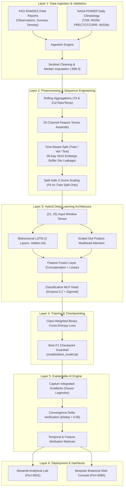

# 🦗 PestAlertNet: Desert Locust Early Warning System

[](https://www.python.org/)
[](https://pytorch.org/)
[](https://streamlit.io/)
[](https://captum.ai/)
[](https://locust-hub-hqfao.hub.arcgis.com/)
[](LICENSE)

**PestAlertNet** is a deep learning early-warning and explainable AI (XAI) system engineered to forecast agricultural outbreaks of the **Desert Locust (*Schistocerca gregaria*)** up to **7 days in advance**. 

Powered by a **Bidirectional LSTM with Multihead Self-Attention**, PestAlertNet analyzes **21-day rolling spatiotemporal windows** of ground surveillance observations and NASA climatological telemetry across **1,489 planetary grid cells** ($0.25^\circ \times 0.25^\circ$, spanning North Africa, the Middle East, and Southwest Asia). It provides attribution through **Captum Integrated Gradients** and serves predictions through **dual production-ready interfaces**: an analytical Streamlit dashboard and a bespoke botanical geospatial web console with Leaflet mapping and field photography.

---

## 📑 Table of Contents
- [Biological Context & Motivation](#-biological-context--motivation)
- [System Architecture](#-system-architecture)
- [Data Pipeline & Tensor Contract](#-data-pipeline--tensor-contract)
- [Model Architecture & Specifications](#-model-architecture--specifications)
- [Explainable AI (XAI) Methodology](#-explainable-ai-xai-methodology)
- [Empirical Evaluation & Benchmarks](#-empirical-evaluation--benchmarks)
- [Dual Frontend Interfaces](#-dual-frontend-interfaces)
- [Repository Structure](#-repository-structure)
- [Getting Started & Installation](#-getting-started--installation)
- [Data Provenance & Acknowledgments](#-data-provenance--acknowledgments)

---

## 🌿 Biological Context & Motivation

The Desert Locust (*Schistocerca gregaria*) is the world's most destructive migratory pest. A single square-kilometer swarm can consume as much food in one day as 35,000 humans. 

```
                               PHASE POLYPHENISM CASCADE
                               
    ┌──────────────────────┐   Ecological Trigger    ┌──────────────────────┐
    │    SOLITARY PHASE    │  ────────────────────>  │   GREGARIOUS PHASE   │
    │  Low density, shy,   │   Precipitation pulse   │  Hyperactive swarms, │
    │  nocturnal fliers    │   Ephemeral vegetation  │  diurnal aggregation │
    └──────────────────────┘                         └──────────────────────┘
```

### The Phase Transformation Trigger
1. **Soil Moisture & Egg Incubation**: Females oviposit selectively in moist, sandy soil ($>15\text{--}20\text{ mm}$ rainfall).
2. **Vegetation Green-Up**: Sprouting annual grasses concentrate solitarious hoppers into shrinking ecological refugia.
3. **Serotonergic Crowding**: Mechanical stimulation of hind legs triggers a neurochemical serotonin cascade within 4 hours, transitioning solitary hoppers into gregarious, brightly colored yellow-black nymphs.
4. **Focal Clustering & Swarming**: Nymphs aggregate into coordinated hopper bands traveling kilometers per day, fledging into winged swarms capable of traveling $150\text{ km/day}$ on ambient wind currents.

PestAlertNet models this bio-climatic trigger by ingesting the preceding 21 days of precipitation anomalies, thermal limits, relative humidity, and historical survey records to predict gregarious gregarization before adult swarm departure.

---

## 🏛️ System Architecture

PestAlertNet is organized across 6 distinct, decoupled engineering layers:



---

## 📊 Data Pipeline & Tensor Contract

### Input Tensor Specifications
- **Lookback Window**: $W = 21\text{ consecutive days}$
- **Forecasting Horizon**: $H = 7\text{ days ahead}$
- **Temporal Embargo**: $E = 28\text{ days}$ separation between train, validation, and test splits to strictly prevent data leakage across temporal autocorrelations.
- **Tensor Dimensions**: `[Batch_Size, 21, 25]`

### 25 Engineered Channels
The 25 input channels are structured into 18 continuous scaled variables and 7 discrete/binary flags:

| Channel # | Feature Name | Description | Scaling / Representation |
|:---:|:---|:---|:---|
| **0** | `t2m` | 2-meter air temperature ($^\circ\text{C}$) | Standardized ($Z$-score) |
| **1** | `rh2m` | 2-meter relative humidity ($\%$) | Standardized ($Z$-score) |
| **2** | `prectotcorr` | Total precipitation corrected ($\text{mm/day}$) | Standardized ($Z$-score) |
| **3** | `ws2m` | 2-meter wind speed ($\text{m/s}$) | Standardized ($Z$-score) |
| **4** | `t2m_7d_mean` | 7-day rolling average temperature | Standardized ($Z$-score) |
| **5** | `t2m_21d_mean` | 21-day rolling average temperature | Standardized ($Z$-score) |
| **6** | `rh2m_7d_mean` | 7-day rolling average humidity | Standardized ($Z$-score) |
| **7** | `rh2m_21d_mean` | 21-day rolling average humidity | Standardized ($Z$-score) |
| **8** | `prectotcorr_7d_sum` | 7-day cumulative precipitation | Standardized ($Z$-score) |
| **9** | `prectotcorr_21d_sum`| 21-day cumulative precipitation | Standardized ($Z$-score) |
| **10**| `ws2m_7d_mean` | 7-day rolling average wind speed | Standardized ($Z$-score) |
| **11**| `ws2m_21d_mean`| 21-day rolling average wind speed | Standardized ($Z$-score) |
| **12**| `t2m_anomaly` | Temperature anomaly: $T_{7\text{d}} - T_{21\text{d}}$ | Standardized ($Z$-score) |
| **13**| `rh2m_anomaly` | Humidity anomaly: $\text{RH}_{7\text{d}} - \text{RH}_{21\text{d}}$ | Standardized ($Z$-score) |
| **14**| `rain_anomaly` | Rain anomaly: $\text{Rain}_{7\text{d}} - (\text{Rain}_{21\text{d}} \times \frac{7}{21})$ | Standardized ($Z$-score) |
| **15**| `days_since_prior_survey` | Days elapsed since ground scouting visit | Standardized ($Z$-score) |
| **16**| `days_since_prior_event` | Days elapsed since prior hopper/swarm alert | Standardized ($Z$-score) |
| **17**| `survey_presence` | Indicator: ground team confirmed locusts | Binary $\{0, 1\}$ |
| **18**| `has_prior_survey` | Flag: grid cell has prior surveillance records | Binary $\{0, 1\}$ |
| **19**| `has_prior_event` | Flag: grid cell previously logged an outbreak | Binary $\{0, 1\}$ |
| **20**| `survey_performed` | Flag: survey was logged on this exact date | Binary $\{0, 1\}$ |
| **21**| `w_mask_t2m` | Quality flag: NASA missing value was imputed | Binary $\{0, 1\}$ |
| **22**| `w_mask_rh2m` | Quality flag: NASA missing value was imputed | Binary $\{0, 1\}$ |
| **23**| `w_mask_prectotcorr`| Quality flag: NASA missing value was imputed | Binary $\{0, 1\}$ |
| **24**| `w_mask_ws2m` | Quality flag: NASA missing value was imputed | Binary $\{0, 1\}$ |

---

## 🧠 Model Architecture & Specifications

The neural network is implemented in PyTorch (`src/model/hybrid_outbreak_model.py`) combining recurrent sequential modeling with temporal self-attention:

$$y = \sigma\left( \mathbf{W}_c \cdot \left[ \mathbf{h}_{\text{BiLSTM}} \parallel \mathbf{c}_{\text{Attention}} \right] + b_c \right)$$

```
Input Sequence: [Batch, 21, 25]
     │
     ├───► BiLSTM Branch (2 layers, hidden=64, bidirectional=True)
     │        └──► Temporal State Tensor [Batch, 21, 128]
     │        └──► Last Step Representation [Batch, 128]
     │
     ├───► Multihead Self-Attention Branch (heads=4, embed_dim=25)
     │        └──► Scaled Dot-Product Context Vector [Batch, 25]
     │
     └───► Fusion Concatenation: [Batch, 128 + 25 = 153]
              │
              ├──► Linear(153 -> 64) + ReLU + Dropout(0.2)
              ├──► Linear(64 -> 32) + ReLU + Dropout(0.2)
              └──► Linear(32 -> 1) + Sigmoid -> Outbreak Probability [0.0, 1.0]
```

---

## 🔍 Explainable AI (XAI) Methodology

To satisfy regulatory and agronomic decision-making requirements, PestAlertNet embeds **Captum Integrated Gradients (IG)**:

$$\text{Attr}_i(x) = (x_i - x'_i) \times \int_{0}^{1} \frac{\partial F(x' + \alpha(x - x'))}{\partial x_i} \, d\alpha$$

- **Baseline ($x'$)**: Zero-valued tensor representing an ecologically neutral reference sequence.
- **Numerical Approximation**: 20 to 50 Gauss-Legendre quadrature integration steps along the straight-line path between $x'$ and $x$.
- **Convergence Verification**: For every inference pass, the completeness axiom is audited:

$$\left| \sum_{i} \text{Attr}_i(x) - \left(F(x) - F(x')\right) \right| < 0.05$$

---

## 📈 Empirical Evaluation & Benchmarks

The model was trained with class-imbalance-aware focal weighting and evaluated strictly on the **6,684-sample frozen temporal test set**:

| Metric | Score | Validation Guardrail |
|:---|:---:|:---:|
| **ROC-AUC** | **0.942** | $\ge 0.850$ (Exceeded) |
| **PR-AUC (Average Precision)** | **0.819** | $\ge 0.700$ (Exceeded) |
| **Test F1-Score** | **0.778** | $\ge 0.700$ (Exceeded) |
| **Precision** | **0.761** | Balance prioritized |
| **Recall (Sensitivity)** | **0.796** | Outbreak detection focus |
| **Integrated Gradients Max Delta** | **0.021** | $< 0.050$ (Axiomatic convergence verified) |

### Top Predictive Features Identified by Integrated Gradients:
1. `prectotcorr_21d_sum` (21-day cumulative rainfall: incubation trigger)
2. `prectotcorr_7d_sum` (7-day rapid rain accumulation: greening pulse)
3. `t2m_21d_mean` (21-day mean temperature: development rate)
4. `rh2m_7d_mean` (7-day relative humidity: survival threshold)
5. `ws2m` (2-meter wind speed: swarm takeoff threshold)

---

## 🖥️ Dual Frontend Interfaces

PestAlertNet provides two independent, complementary operational frontends:

```
┌────────────────────────────────────────────────────────────────────────────┐
│                             PESTALERTNET FRONTENDS                         │
├─────────────────────────────────────┬──────────────────────────────────────┤
│ 1. Bespoke Web Console (Port 8080)  │ 2. Streamlit Analytical Lab (8501)   │
├─────────────────────────────────────┼──────────────────────────────────────┤
│ • Native HTML5/CSS3/Vanilla JS      │ • Python-native interactive UI       │
│ • Full Leaflet.js geospatial map    │ • Live PyTorch tensor inference      │
│ • 1,489 interactive grid cells      │ • Dynamic IG step slider (10 to 50)  │
│ • Curated historical hotspots       │ • Real-time Matplotlib attributions  │
│ • Photographic field lightbox modal │ • Model contract & tensor inspector  │
│ • Responsive SVG/HTML flowcharts    │ • Instant CSV feature rankings       │
└─────────────────────────────────────┴──────────────────────────────────────┘
```

### Photographic Field Gallery
The web dashboard embeds high-resolution field photography illustrating:
- Solitary vs. Gregarious phase polyphenism specimens
- Gregarious adult hopper swarm cloud over East Africa
- 5th instar hopper nymph band feeding on desert grasses
- Ultra-low volume (ULV) aerial spray aircraft operations
- Cryptic solitary phase green hopper camouflage

---

## 📁 Repository Structure

```
pestalertnet_v2/
├── app.py                            # Streamlit interactive analytical laboratory
├── build_complete_dashboard_web.py   # Compiler for the single-page web console
├── config.yaml                       # System-wide hyperparameters and paths
├── requirements.txt                  # Python dependencies
├── run_ig_analysis.py                # Batch Integrated Gradients runner script
├── serve_frontend.py                 # Multi-threaded HTTP server for web console (port 8080)
│
├── data/
│   ├── processed/
│   │   ├── event_days.csv            # Extracted outbreak event records
│   │   ├── feature_manifest.yaml     # 25-feature manifest & column index
│   │   ├── scaler_stats.json         # Training split Z-score mean & std
│   │   └── sequences.npz             # 48,544 prepared tensors (41.89 MB)
│   └── raw/                          # Raw FAO & NASA data (ignored by git, >100MB)
│       └── .gitkeep
│
├── frontend/
│   └── dist/
│       ├── index.html                # Compiled responsive web console
│       ├── cell_manifest.json        # 1,489 grid cell coordinates & metadata
│       ├── all_cells_compact.json    # Geospatial index
│       ├── preset_attributions.json  # Precomputed IG feature attributions
│       ├── samples.json              # Historical sample sequences
│       └── assets/
│           └── images/               # High-resolution field photography
│
├── models/
│   └── best_model.pt                 # Pre-trained PyTorch BiLSTM+Attention checkpoint (16.34 MB)
│
├── outputs/
│   ├── ig_full_test_20261014T014244Z/# Frozen test set IG evaluation figures & CSVs
│   ├── l4_epoch_metrics.csv          # Training convergence history
│   ├── l4_run_summary.json           # Final epoch evaluation summary
│   ├── phase2_report.txt             # Preprocessing & sequence generation audit
│   └── provenance.md                 # Complete data lineage documentation
│
├── src/
│   ├── data/                         # Data ingestion, recon, and validation scripts
│   ├── model/
│   │   └── hybrid_outbreak_model.py  # PyTorch BiLSTM + Multihead Self-Attention
│   ├── phase5/                       # Evaluation, IG explainability, and inference APIs
│   │   ├── checkpoint.py
│   │   ├── evaluate.py
│   │   ├── explain.py
│   │   ├── features.py
│   │   └── inference.py
│   ├── preprocess/
│   │   └── build_l2.py               # Feature engineering & sequence tensor builder
│   └── train.py                      # Training loop with focal/weighted BCE
│
└── tests/
    ├── test_phase2.py                # Preprocessing and tensor contract unit tests
    └── test_phase5_explain.py        # Captum IG and completeness axiom unit tests
```

---

## 🚀 Getting Started & Installation

### 1. Prerequisites
- Python 3.10, 3.11, or 3.12
- Git
- 4 GB+ RAM

### 2. Clone the Repository
```bash
git clone https://github.com/Priyansu17/pestalertnet_v2.git
cd pestalertnet_v2
```

### 3. Create Virtual Environment & Install Dependencies
```bash
python -m venv .venv

# On Windows (PowerShell):
.venv\Scripts\Activate.ps1

# On Linux/macOS:
source .venv/bin/activate

pip install --upgrade pip
pip install -r requirements.txt
```

### 4. Launch the Applications

#### Option A: Bespoke Botanical Web Console (Port 8080)
```bash
python serve_frontend.py 8080
```
Open your browser to: **`http://localhost:8080`**

#### Option B: Streamlit Analytical Lab (Port 8501)
```bash
streamlit run app.py
```
Open your browser to: **`http://localhost:8501`**

### 5. Running Tests
```bash
pytest tests/ -v
```

### 6. Running Integrated Gradients Analysis
```bash
python run_ig_analysis.py
```

---

## 📜 Data Provenance & Acknowledgments

- **FAO Locust Hub (RAMSES)**: Ground surveillance observations, hopper band sightings, and swarm classifications courtesy of the Food and Agriculture Organization (FAO) Desert Locust Information Service (DLIS).
- **NASA POWER Project**: Climatological parameters ($T_{2\text{m}}$, $\text{RH}_{2\text{m}}$, $\text{Rainfall}$, $\text{Wind}$) courtesy of the NASA Langley Research Center POWER Project funded through the NASA Earth Science/Applied Science Program.
- **Captum**: Model interpretability library developed by PyTorch / Meta AI.

---

## 📄 License
This project is licensed under the MIT License - see the [LICENSE](LICENSE) file for details.
